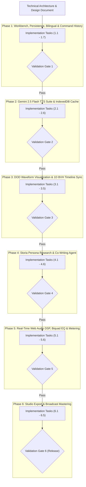

# Storia: Master Implementation Plan

*Reference Architecture: [Storia Technical Architecture & Design Document](./narration_podcast_editor_design_document.md)*

This document serves as the master implementation index for **Storia** (*The Intelligent Audio Drama, Podcast & Narration Studio*). The implementation is structured into **6 sequential phases**, each documented in its own dedicated engineering specification and gated by mandatory automated and interactive validation checks before proceeding to the next phase.

---

## Phased Execution & Validation Pipeline



---

## Phase-by-Phase Implementation Documents

| Phase | Document | Core Deliverables | Key Validation Criteria |
| :--- | :--- | :--- | :--- |
| **Phase 1** | [Phase 1: Workbench, Persistence, Bilingual Foundation & Command History](./phases/phase_1_workbench_and_foundation.md) | Vite + React 19 + TS scaffold, core schemas, EN/HR localization, WPM & audio token calculator, Command pattern (`HistoryManager`), Zustand persistence, 3-pane studio layout. | 100-step Undo/Redo invariant tests, WPM/token math verification, bilingual hot-swapping, `localStorage` session restore. |
| **Phase 2** | [Phase 2: Gemini 2.5 Flash TTS Synthesis Suite & IndexedDB Audio Cache](./phases/phase_2_gemini_tts_and_cache.md) | BYOK key vault, `gemini-2.5-flash-preview-tts` client, offline procedural PCM fallback, `[...]` didaskalije parser, SSML `<mark>`/`<break>` builder, SoA peak extraction, SHA-256 IndexedDB cache. | SSML & system directive tests, SoA peak envelope accuracy against synthetic waves, cache hit & `[TTS: Stale]` invalidation tests. |
| **Phase 3** | [Phase 3: Data-Oriented Waveform Visualization & 1D BVH Timeline Sync](./phases/phase_3_dod_waveform_and_bvh_timeline.md) | 1D Temporal BVH (Interval Tree) for $O(\log N)$ lookups, decoupled audio clock accumulator with Lerp interpolation, zero-allocation Canvas 2D SoA renderer, `frameloop="demand"`. | $O(\log N)$ depth verification across 1,000 blocks, Lerp monotonicity under frame jitter, $0\%$ idle CPU consumption when paused. |
| **Phase 4** | [Phase 4: Storia Persona Research & Co-Writing Agent](./phases/phase_4_persona_research_and_cowriter.md) | `gemini-3-flash-preview` client, Google Search grounding with citations, Persona POV Research Notebook, JSON-schema Co-Writer, Vocal Cadence Script Doctor, EN/HR Cultural Adapter. | Grounding citation extraction tests, structured `ScriptBlock[]` schema validation, Croatian gender agreement verification, Command undo integration. |
| **Phase 5** | [Phase 5: Real-Time Web Audio DSP, Biquad EQ & Master Chain](./phases/phase_5_realtime_dsp_and_master_chain.md) | Per-speaker RBJ Biquad EQ ($120\text{ Hz}$, $2.5\text{ kHz}$, $8\text{ kHz}$) + Compressor, ITU-R BS.1770-4 K-weighted LUFS meter, lock-free SPSC `AudioWorklet` + denormal guard, multi-speaker lookahead player. | Biquad transfer function gain tests, SPSC ring buffer wrap-around invariants, $-16\text{ LUFS}$ reference calibration, glitch-free live EQ sweeping. |
| **Phase 6** | [Phase 6: Studio Export & Broadcast Mastering](./phases/phase_6_studio_export_and_mastering.md) | `OfflineAudioContext` mastering & $-16\text{ LUFS}$ normalization, TPDF dither generator, $44.1/48\text{ kHz}$ & $16/24/32\text{-bit}$ RIFF/WAV encoder (master & stems), Fountain/Markdown/JSON exporters. | Binary RIFF/WAVE header verification, TPDF triangular variance tests, $-1.0\text{ dBFS}$ ceiling enforcement, `.storia.json` round-trip integrity. |

---

## Target Repository Directory Tree

```text
h:/Projects/Storia/
├── docs/
│   ├── narration_podcast_editor_design_document.md
│   ├── implementation_plan.md
│   └── phases/
│       ├── phase_1_workbench_and_foundation.md
│       ├── phase_2_gemini_tts_and_cache.md
│       ├── phase_3_dod_waveform_and_bvh_timeline.md
│       ├── phase_4_persona_research_and_cowriter.md
│       ├── phase_5_realtime_dsp_and_master_chain.md
│       └── phase_6_studio_export_and_mastering.md
├── public/
│   └── worklets/
│       └── spsc-playback-processor.js     # Lock-free SPSC AudioWorklet + denormal protection
├── src/
│   ├── types/
│   │   └── storia.ts                      # Core schemas (Project, Speaker, ScriptBlock, WaveformPeakData, etc.)
│   ├── i18n/
│   │   ├── dictionary.ts                  # Zero-dependency EN / HR localization strings
│   │   ├── sampleProject.ts               # Bilingual default project ("Ep 1: Magla nad Zagrebom")
│   │   └── useTranslation.ts              # Reactive language hook
│   ├── core/
│   │   ├── history/
│   │   │   ├── Command.ts                 # Command interface & HistoryManager
│   │   │   └── commands/                  # Concrete undoable commands
│   │   ├── pacing/
│   │   │   └── pacingCalculator.ts        # WPM duration estimator, SSML break parser & audio token estimator (25 tok/s)
│   │   ├── spatial/
│   │   │   ├── TemporalBVH.ts             # 1D Interval Tree / BVH for O(log N) block & timepoint lookups
│   │   │   └── ClockInterpolator.ts       # Fixed-timestep accumulator & Lerp scrubber decoupler
│   │   ├── dsp/
│   │   │   ├── BiquadChain.ts             # Per-speaker 120Hz Low-Shelf, 2.5kHz Mid-Peak, 8kHz High-Shelf + Compressor
│   │   │   ├── LoudnessMeter.ts           # ITU-R BS.1770-4 (-16 LUFS) & True Peak (-1.0 dBFS) analyzer
│   │   │   ├── RingBufferSPSC.ts          # SharedArrayBuffer + Atomics lock-free queue
│   │   │   └── TpdfDither.ts              # Triangular PDF dithering & PCM 16/24/32-bit WAV encoder
│   │   └── storage/
│   │       ├── audioCache.ts              # IndexedDB (idb-keyval) blob + SoA peak cache with content-hash invalidation
│   │       └── keyVault.ts                # BYOK local storage & Web Crypto API key manager
│   ├── services/
│   │   ├── geminiTtsService.ts            # gemini-2.5-flash-preview-tts client, didaskalije parser, SSML & SoA peak extractor
│   │   ├── geminiAgentService.ts          # gemini-3-flash-preview Persona Research (Search Grounding), Co-Writer, Doctor, Adapter
│   │   └── scriptExportService.ts         # Fountain (.fountain), Markdown (.md), and Project JSON exporters
│   ├── store/
│   │   └── useStoriaStore.ts              # Dual-tier Zustand store (structural state + HistoryManager binding)
│   ├── components/
│   │   ├── layout/
│   │   │   ├── TopBar.tsx                 # Project selector, EN/HR toggle, Undo/Redo, Token budget meter, API Key, Export
│   │   │   ├── CastSidebar.tsx            # Left 240px speaker roster, voice badges, acoustic EQ drawer trigger
│   │   │   ├── ScriptWorkbench.tsx        # Center fluid script block editor, transport controls, timeline bar
│   │   │   └── AgentDock.tsx              # Right 340px AI tabs (Persona POV, Co-Writer, Script Doctor, Bilingual Adapter)
│   │   ├── workbench/
│   │   │   ├── ScriptBlockCard.tsx        # Block editor, speaker badge, [directorNotes] highlight, inline waveform
│   │   │   └── WaveformCanvas.tsx         # DOD Canvas 2D SoA renderer with frameloop="demand"
│   │   └── modals/
│   │       ├── SpeakerConfigModal.tsx     # Base voice (Puck, Kore, Fenrir...), persona prompt, acting notes, Biquad EQ sliders
│   │       ├── ApiKeyModal.tsx            # BYOK setup & model settings
│   │       └── ExportMasterModal.tsx      # WAV 44.1/48kHz, 16/24/32-bit, TPDF dither, -16 LUFS mastering & script export
│   ├── App.tsx
│   └── main.tsx
├── tests/
│   ├── phase1/
│   ├── phase2/
│   ├── phase3/
│   ├── phase4/
│   ├── phase5/
│   └── phase6/
├── package.json
├── tsconfig.json
└── vite.config.ts
```

---

## Global Validation Protocol

Between every phase, execution halts at a **Validation Gate** consisting of three mandatory stages:
1. **Static Type & Lint Check:** `npm run typecheck` (`tsc --noEmit`) must complete with 0 errors.
2. **Automated Test Suite (`vitest`):** All phase-specific unit and integration tests (`npm run test:phaseX`) plus regression suites from all prior phases must pass 100%.
3. **Interactive Studio Verification:** Manual verification of the running application against the phase's functional and performance checklist before unlocking the next phase.

